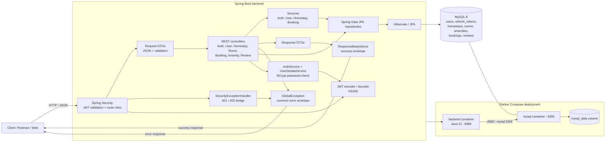

# Homestay Booking System — Phase 1

REST API đặt homestay xây dựng bằng Java và Spring Boot.

## Phase 1 gồm những gì

- Tài khoản người dùng, đăng nhập và phân quyền `USER` / `ADMIN`.
- Quản lý homestay, phòng và tiện nghi.
- Tạo, cập nhật, hủy và theo dõi booking; kiểm tra ngày, sức chứa và trùng lịch.
- Thanh toán được biểu diễn bằng trạng thái (`UNPAID`, `PAID`, `REFUNDED`);
- Đánh giá booking đã hoàn tất; tối đa một review trên mỗi booking.
- REST API, validation, phản hồi lỗi và tài liệu OpenAPI.

## Công nghệ và kiến trúc

Java 21, Spring Boot 4.1.1, Spring MVC, Spring Data JPA/Hibernate, Spring Security OAuth2 Resource Server (JWT), Jakarta Validation, MySQL 8 và Maven Wrapper. H2 được dùng trong test.

Luồng xử lý chính: HTTP → `controller` → request/response `dto` → `service` (nghiệp vụ) → `repository` → MySQL. `domain` chứa entity/enum; `config` cấu hình security, JWT, password và OpenAPI; `util` xử lý response và lỗi. DTO giúp API không phụ thuộc trực tiếp vào entity. Đặt logic nghiệp vụ trong service, truy vấn trong repository và kiểm tra đầu vào tại DTO/service.

### Sơ đồ kiến trúc

Sơ đồ dưới đây mô tả các thành phần trong source hiện tại và cách request đi qua backend đến database. Các API nghiệp vụ trả DTO; `ResponseBodyAdvice` bọc response thành công, còn lỗi MVC và lỗi từ Security được chuẩn hóa qua `GlobalException`.



Khi chạy bằng Docker, máy host gọi backend qua `localhost:8080` (hoặc cổng được đặt trong `.env`); backend kết nối database qua hostname `mysql:3306` trong mạng Compose. Khi chạy local không dùng Docker, backend thường kết nối MySQL host qua `localhost:3306`.

Các entity chính: `User`, `Homestay`, `Room`, `Amenity`, `Booking`, `Review`, `RefreshToken`. Booking lưu snapshot giá mỗi đêm để tổng tiền không đổi khi giá phòng đổi sau đó. Booking có thể gắn phòng hoặc chỉ homestay; homestay có thể có trạng thái `PENDING`, `APPROVED`, `REJECTED`, `INACTIVE`. Xem entity và service trong `src/main/java/com/example/Homestay_Booking_System/` để biết quy tắc đang được triển khai.

## Cấu trúc thư mục

```text
src/
├── main/java/com/example/Homestay_Booking_System/
│   ├── config/       # Security, JWT, password, OpenAPI
│   ├── controller/   # REST endpoints, nhận request/trả response
│   ├── domain/       # JPA entities và enum trạng thái
│   ├── dto/
│   │   ├── request/  # Payload đầu vào và validation
│   │   └── response/ # Payload trả về client
│   ├── repository/   # Truy vấn và persistence qua Spring Data JPA
│   ├── service/      # Nghiệp vụ và điều phối thao tác dữ liệu
│   └── util/         # Response chung, exception và annotation
├── main/resources/   # application.properties, cấu hình ứng dụng
└── test/java/        # Unit/integration tests
postman/              # Postman collection để gọi thử API
pom.xml               # Dependencies và cấu hình Maven/build
mvnw, mvnw.cmd        # Maven Wrapper cho Linux/macOS và Windows
target/               # Artifact build; không chỉnh sửa source tại đây
```

Khi thêm tính năng Phase 2, tạo DTO request/response và endpoint trong các package tương ứng; đặt quy tắc nghiệp vụ ở `service`, truy cập DB ở `repository`, và cập nhật `domain` nếu cần thêm dữ liệu/trạng thái. Bổ sung test trong `src/test` và cập nhật Postman/OpenAPI khi API thay đổi.
## Clone và chạy local

Yêu cầu: Git, JDK 21 và MySQL 8. Không cần cài riêng maven vì repo có Maven Wrapper.

1. Clone repo và chuyển vào thư mục dự án.
2. Tạo database `homestay_db` (hoặc đổi `DB_URL`).
3. Thiết lập biến môi trường. Ví dụ trên PowerShell:

```powershell
$env:DB_URL = "jdbc:mysql://localhost:3306/homestay_db?createDatabaseIfNotExist=true&serverTimezone=Asia/Ho_Chi_Minh&allowPublicKeyRetrieval=true"
$env:DB_USERNAME = "root"
$env:DB_PASSWORD = "<mat-khau-mysql>"
$env:JWT_SECRET = "<chuoi-bi-mat-base64-dai-va-ngau-nhien>"
```

`DB_URL` mặc định đã trỏ tới MySQL local. `DB_PASSWORD` và `JWT_SECRET` là bắt buộc; không commit secret. Có thể dùng `application-local.properties` cho cấu hình máy cá nhân; file này đã được bỏ qua trong Git.

Chạy ứng dụng:

```powershell
# Windows
.\mvnw.cmd spring-boot:run

# Linux/macOS
./mvnw spring-boot:run
```

Mặc định API chạy tại `http://localhost:8080`. Hibernate đang đặt `ddl-auto=update`, nên khi khởi động sẽ tự cập nhật schema cho môi trường phát triển.

## Chạy bằng Docker

Yêu cầu: Git và Docker Desktop đang chạy Linux containers. Docker build backend bằng Java 21/Maven và chạy MySQL 8.4; không cần cài Java, Maven hoặc MySQL riêng trên máy.

1. Clone repo và chuyển vào thư mục dự án:

```powershell
git clone https://github.com/ryanleeswe/Homestay-Booking-System.git
cd Homestay-Booking-System
```

Nếu cấu hình Docker chưa được merge vào `main`, chạy `git switch hoangd` để dùng nhánh có cấu hình này.

2. Tạo `.env` từ mẫu:

```powershell
# Windows PowerShell
Copy-Item .env.example .env
```

```bash
# Linux/macOS
cp .env.example .env
```

Mở `.env`, thay `DOCKER_MYSQL_ROOT_PASSWORD` và `DOCKER_MYSQL_PASSWORD` bằng hai mật khẩu riêng cho database Docker. Điền `JWT_SECRET` là chuỗi Base64 của ít nhất 32 byte ngẫu nhiên. Tạo secret bằng PowerShell rồi sao chép kết quả vào `.env`:

```powershell
$jwtBytes = New-Object byte[] 32
$rng = [System.Security.Cryptography.RandomNumberGenerator]::Create()
$rng.GetBytes($jwtBytes)
$rng.Dispose()
[Convert]::ToBase64String($jwtBytes)
```

Giữ secret cho các lần chạy sau; không commit `.env`. Compose ưu tiên biến môi trường của terminal hơn giá trị cùng tên trong `.env`.

3. Build và khởi động tại thư mục dự án:

```powershell
docker compose config --quiet
docker compose up -d --build
docker compose ps
docker compose logs -f backend
```

Lần đầu cần Internet để tải image và dependency Maven. Khi log có `Started HomestayBookingSystemApplication`, backend đã sẵn sàng. Nhấn Ctrl+C để thoát xem log; container vẫn chạy nền. Dockerfile bỏ qua test khi build image.

API Docker mặc định tại `http://localhost:8081`; Swagger UI tại `http://localhost:8081/swagger-ui.html`, OpenAPI JSON tại `http://localhost:8081/v3/api-docs`. Khi dùng mục API bên dưới với Docker, thay cổng `8080` bằng `8081`.

MySQL Docker truy cập từ máy tại `127.0.0.1:3307`, database `homestay_db`, username `homestay`, password là `DOCKER_MYSQL_PASSWORD`. Backend kết nối nội bộ tới `mysql:3306`. Database Docker tách biệt MySQL cài trên máy; dữ liệu cũ không tự chuyển sang. Đổi `BACKEND_PORT` hoặc `MYSQL_PORT` trong `.env` nếu cổng bị chiếm.

4. Dừng hoặc chạy lại:

```powershell
docker compose down
docker compose up -d
# Sau khi sửa code
docker compose up -d --build
```

`down` giữ volume database; không thêm `-v` nếu cần giữ dữ liệu. Đổi mật khẩu trong `.env` không tự đổi mật khẩu database đã khởi tạo; cần cập nhật mật khẩu tương ứng trong MySQL. Hibernate dùng `ddl-auto=update` để cập nhật schema khi khởi động trong môi trường phát triển.

## API và kiểm tra nhanh

Các nhóm endpoint: `/auth` (login/refresh/logout), `/users`, `/homestays`, `/homestays/{homestayId}/rooms`, `/amenities`, `/homestays/{homestayId}/amenities`, `/bookings`, `/bookings/{bookingId}/review`. Một số thao tác yêu cầu đăng nhập hoặc role `ADMIN`; gửi access token bằng `Authorization: Bearer <access-token>`.

- Swagger UI: `http://localhost:8080/swagger-ui.html`
- OpenAPI JSON: `http://localhost:8080/v3/api-docs`
- Postman: [`postman/Homestay-Booking-System.postman_collection.json`](postman/Homestay-Booking-System.postman_collection.json)

## Build và triển khai

Tạo artifact có thể chạy trên máy/VM/container đã cài JDK 21 và truy cập MySQL:

```powershell
# Windows
.\mvnw.cmd clean package
java -jar target/Homestay-Booking-System-0.0.1-SNAPSHOT.jar
```

```bash
# Linux/macOS
./mvnw clean package
java -jar target/Homestay-Booking-System-0.0.1-SNAPSHOT.jar
```

Khi triển khai, cấp `DB_URL`, `DB_USERNAME`, `DB_PASSWORD`, `JWT_SECRET` qua secret/environment của nền tảng, mở cổng ứng dụng (mặc định 8080) và cấu hình MySQL truy cập được từ dịch vụ.

