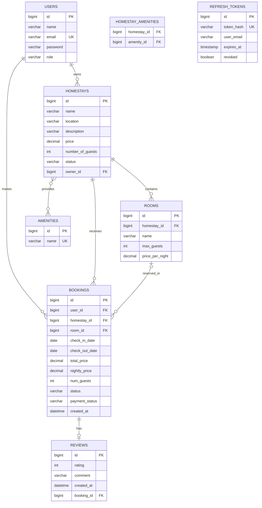

# Homestay Booking System

REST API quản lý homestay, phòng, tiện nghi, người dùng và đặt phòng. Dự án sử dụng kiến trúc phân lớp với Spring Boot, Spring Data JPA và Spring Security JWT.

## 1. Đặc tả dự án

### Mục tiêu

- Đăng ký, đăng nhập và quản lý người dùng.
- Quản lý homestay, phòng và tiện nghi.
- Tạo, cập nhật, hủy và theo dõi đặt phòng.
- Đánh giá đặt phòng từ 1 đến 5 sao.
- Phân quyền bằng hai vai trò `USER` và `ADMIN`.
- Cung cấp API documentation qua Swagger/OpenAPI.

### Công nghệ

| Thành phần | Công nghệ |
|---|---|
| Ngôn ngữ | Java 21 |
| Framework | Spring Boot 4.1.1 |
| Web | Spring MVC |
| ORM | Spring Data JPA / Hibernate |
| Database | MySQL; H2 cho test |
| Authentication | Spring Security, OAuth2 Resource Server, JWT |
| Validation | Jakarta Bean Validation |
| API docs | Springdoc OpenAPI |
| Build | Maven Wrapper |

### Nghiệp vụ chính

- Email người dùng bắt buộc, đúng định dạng và duy nhất.
- Mật khẩu không được trả về trong response.
- Giá homestay/phòng phải lớn hơn `0`; số khách tối thiểu là `1`.
- Ngày trả phòng phải sau ngày nhận phòng.
- Phòng không khả dụng khi có booking `PENDING` hoặc `CONFIRMED` bị trùng thời gian.
- Số khách của booking phải từ `1` và không vượt quá sức chứa của phòng (hoặc homestay nếu không chọn phòng).
- Booking có các trạng thái: `PENDING`, `CONFIRMED`, `CANCELLED`, `COMPLETED`.
- Thanh toán có các trạng thái: `UNPAID`, `PAID`, `REFUNDED`.
- Mỗi booking có tối đa một review.
- Chỉ người sở hữu booking mới được tạo review; chỉ booking `COMPLETED` mới được review.

## 2. API

| Nhóm | Endpoint | Chức năng |
|---|---|---|
| Health/Auth | `GET /`, `POST /auth/login`, `POST /auth/refresh`, `POST /auth/logout` | Kiểm tra hệ thống và xác thực |
| Users | `/users` | Quản lý người dùng |
| Homestays | `/homestays` | CRUD, tìm kiếm và lọc homestay |
| Rooms | `/homestays/{homestayId}/rooms` | Quản lý phòng |
| Amenities | `/amenities`, `/homestays/{homestayId}/amenities` | Quản lý tiện nghi |
| Bookings | `/bookings` | Quản lý đặt phòng |
| Reviews | `/bookings/{bookingId}/review` | Quản lý đánh giá |

Swagger UI: `http://localhost:8080/swagger-ui.html`
OpenAPI JSON: `http://localhost:8080/v3/api-docs`

Request Postman: [`postman/Homestay-Booking-System.postman_collection.json`](postman/Homestay-Booking-System.postman_collection.json)

Ví dụ tạo booking:

```json
{
  "userId": 1,
  "homestayId": 1,
  "roomId": 1,
  "checkInDate": "2026-11-01",
  "checkOutDate": "2026-11-03",
  "numGuests": 2
}
```

`numGuests` có thể bỏ qua để dùng giá trị mặc định là `1`.

## 3. Kiến trúc ứng dụng

```text
HTTP Client
    │
    ▼
Controller ──► DTO request/response ──► Service ──► Repository ──► MySQL
    │                 │                    │
    │                 └── Validation        └── Domain entity/business rules
    │
    └── Spring Security FilterChain ──► JWT authentication/authorization
```

- `controller`: nhận HTTP request và trả response.
- `dto`: định nghĩa payload request/response, tách API khỏi entity.
- `service`: xử lý nghiệp vụ ứng dụng.
- `repository`: truy cập dữ liệu bằng Spring Data JPA.
- `domain`: entity, enum và logic nghiệp vụ.
- `config`: cấu hình Security, JWT, password và OpenAPI.
- `util`: response wrapper, annotation và xử lý exception.

## 4. Kiến trúc thư mục

```text
Homestay-Booking-System/
├── pom.xml
├── mvnw, mvnw.cmd
├── README.md
├── HELP.md
├── postman/
│   └── Homestay-Booking-System.postman_collection.json
├── src/
│   ├── main/
│   │   ├── java/com/example/Homestay_Booking_System/
│   │   │   ├── HomestayBookingSystemApplication.java
│   │   │   ├── config/                  # JWT, Security, OpenAPI, password
│   │   │   ├── controller/              # REST endpoints
│   │   │   ├── domain/                  # JPA entities và enums
│   │   │   ├── dto/
│   │   │   │   ├── request/              # Dữ liệu đầu vào
│   │   │   │   └── response/             # Dữ liệu đầu ra
│   │   │   ├── repository/              # JPA repositories
│   │   │   ├── service/                 # Business services
│   │   │   └── util/
│   │   │       ├── annotation/
│   │   │       └── error/
│   │   └── resources/
│   │       ├── application.properties
│   │       └── application-local.properties
│   └── test/java/...                    # Unit/integration tests
└── target/                              # Build output, không phải source
```

## 5. Mô hình quan hệ bảng UML/ER

Sơ đồ Mermaid dưới đây mô tả quan hệ được khai báo trong các JPA entity:



### Ghi chú lược đồ

- Các bảng chính: `users`, `homestays`, `rooms`, `bookings`, `reviews`, `amenities`, `refresh_tokens`.
- Bảng nối many-to-many: `homestay_amenities`.
- `Homestay.owner` là quan hệ tới `users`, nhưng có thể null theo entity hiện tại.
- `Booking.room` có thể null; khi đó tổng tiền dùng giá homestay.
- `Booking.numGuests` mặc định là `1` và được kiểm tra không vượt quá sức chứa.
- `reviews.booking_id` là duy nhất, nên một booking chỉ có tối đa một review.
- `refresh_tokens.user_email` hiện chỉ là cột dữ liệu, chưa phải foreign key tới `users.id`; service liên kết bằng email.
- `Homestay.status` sử dụng các trạng thái `PENDING`, `APPROVED`, `REJECTED`, `INACTIVE`; endpoint `/homestays/available` chỉ trả về homestay `APPROVED`.
- Request cũ có thể tiếp tục gửi `available`; hệ thống quy đổi `true` thành `APPROVED` và `false` thành `INACTIVE`. Request mới nên gửi `status`.
- `Booking.nightlyPrice` lưu giá mỗi đêm tại thời điểm tạo/cập nhật booking, còn `totalPrice` được tính từ giá snapshot này nên không bị ảnh hưởng khi giá phòng thay đổi về sau.
- `spring.jpa.hibernate.ddl-auto=update` có thể tự cập nhật schema khi chạy. Production nên dùng migration tool.

## 6. Cài đặt và chạy

### Yêu cầu

- JDK 21 trở lên.
- MySQL 8.x.
- Maven không bắt buộc vì dự án có Maven Wrapper.

### Biến môi trường

Không commit password hoặc JWT secret. Trên PowerShell:

```powershell
$env:DB_URL = "jdbc:mysql://localhost:3306/homestay_db?createDatabaseIfNotExist=true&serverTimezone=Asia/Ho_Chi_Minh&allowPublicKeyRetrieval=true"
$env:DB_USERNAME = "root"
$env:SPRING_DATASOURCE_PASSWORD = "<mat-khau-mysql>"
$env:JWT_SECRET = "<bi-mat-jwt-base64>"
```

### Chạy trên Windows

```powershell
.\mvnw.cmd clean test
.\mvnw.cmd spring-boot:run
```

### Chạy trên Linux/macOS

```bash
./mvnw clean test
./mvnw spring-boot:run
```

Ứng dụng chạy mặc định tại `http://localhost:8080`.

## 7. Kiểm thử

```text
src/test/java/com/example/Homestay_Booking_System/
├── ApiResponseTests.java
├── HomestayBookingSystemApplicationTests.java
├── RoomPersistenceTests.java
├── UserIdValidationTests.java
└── UserSecurityTests.java
```

Chạy test:

```powershell
.\mvnw.cmd test
```

## 8. Bảo mật

Endpoint cần xác thực dùng header:

```text
Authorization: Bearer <access-token>
```

- Access token mặc định có hạn 15 phút.
- Refresh token mặc định có hạn 7 ngày.
- Endpoint admin yêu cầu role `ADMIN`.
- Không lưu hoặc ghi log access token, refresh token, password và secret.

## 9. Tài liệu tham khảo

- [Spring Boot](https://docs.spring.io/spring-boot/)
- [Spring Data JPA](https://docs.spring.io/spring-data/jpa/reference/)
- [Spring Security](https://docs.spring.io/spring-security/reference/)
- [Springdoc OpenAPI](https://springdoc.org/)